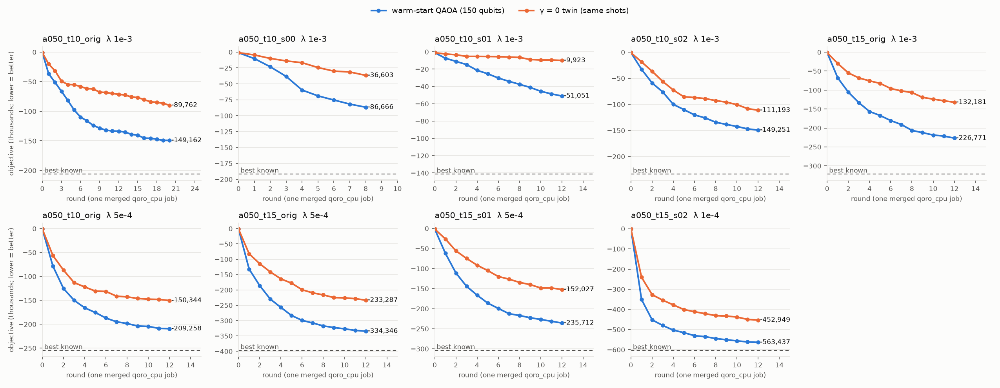

# Where quantum fits in our portfolio pipeline

**In short:** we built a hybrid pipeline, as the challenge kit suggests ("Hybrid loops", notebook 01 §1.8),
and measured every quantum step against a matched classical baseline, as the README asks: *"compare every
quantum result with the classical baselines before claiming a quantum contribution."*

- **Largest quantum programs:** **1,200 qubits**, one whole a400_t15 trading day (400 assets × 3 qubits,
  718,842 couplings), our largest instance; **600 qubits**, one whole a200 day; both simulated with Maestro's
  matrix-product-state (MPS) simulator on our laptop. **150 qubits** on Qoro's cloud: one whole a050 day
  per program, 10–15 programs per merged `qoro_cpu` job (the cloud accepts at most 156 qubits per circuit).
- **What the quantum program is:** warm-started QAOA on one whole day, i.e. the block you get by cutting
  the problem by period, which is the cut that loses the least coupling (table below). The γ = 0 version
  of the same circuit is exactly the classical sampler it starts from, so the comparison is like for like.
- **What it gives:** at 150, 600 and 1,200 qubits, QAOA's samples are 1.2–3× as often feasible as the
  γ = 0 baseline's, and their mean cost above the current day is 20–82% lower. In a hybrid loop on Qoro's
  cloud (sample every day, keep the best improving sample, repeat), the QAOA run is ahead of its γ = 0 twin
  after every round of all 9 loops we ran (a050, λ = 1e-4 to 1e-3; after the last round QAOA is at 1.2–5.1×
  the twin's objective, e.g. −334,346 vs −233,287 on a050_t15_orig λ5e-4).
- **What it does not give:** a better final score than classical search. One hand-in file comes out of the
  hybrid pipeline (a050_t10_s00 λ1e-3, **−192,036**, best known −191,879: 8 cloud QAOA rounds, then classical
  polish), but the classical polish does most of the work there, and classical search alone reaches −191,991.

## What produces the scores

Classical methods produce every other score in `README.md` / `RESULTS.md`: whole-day pair-move iterated
local search (`day_swap.py`) on every instance, an exact dynamic program on a010 (`exact_dp.py`, proven
optimal), and an exact recombination of days across runs (`recombine_runs.py`). Instances go up to 36,165
binary variables (a400_t15). Of the 128 instances with a best-known value, 19 beat it, 108 match it and 1 is
0.045% above it (`RESULTS.md`).

## Warm-started whole-day QAOA, 150 to 1,200 qubits (Maestro MPS, Qoro's cloud)

**The block.** One whole day with every asset in it, the other days fixed. In the signed 3-bit encoding
(below) that is 3 qubits per asset: 150 qubits for a050, 600 for a200, 1,200 for a400. The block's QUBO is
exact up to the budget price μ (0.25 × the block's mean cost of one unit). Script: `warm_day_qaoa.py`.

**Why a warm start.** Standard QAOA starts in the uniform superposition. At 150 qubits its samples were as
good as uniform random bitstrings (median 71–74 units held against a budget of 20; no feasible sample in
500), because the feasible region is an exponentially small corner of the space. So we use warm-start QAOA
(Egger, Mareček, Woerner, *Quantum* 5, 479, 2021): qubit q starts in `RY(θ_q)|0⟩` with
`sin²(θ_q/2) = ε` or `1 − ε` according to the current solution's bit, and the mixer is
`RY(θ_q) RZ(2β) RY(−θ_q)`, which leaves that state unchanged. With γ = 0 the circuit therefore samples
exactly the classical baseline: the current solution with each bit flipped independently with probability ε.
Every difference at γ ≠ 0 is the work of the QAOA cost layer. We use p = 1, γ = 0.25, β = −0.4 (tuned on
30-qubit a010 days; the QUBO is scaled so the median single-flip energy change at the warm start is 1, so the
angles carry over). ε ≈ 3 / #qubits (about 3 flips per sample) around a polished solution, and ε = 0.05 when
building a portfolio up from the empty one.

**Making it simulable.** Every pair of assets on a day is coupled by risk, so the cost layer has an RZZ gate
for every pair of qubits (11,175 at 150 qubits). Written as Divi emits them, these gates span the whole MPS
chain and Maestro spends its time routing: 440 s locally and 418 s on `qoro_cpu` (15 credits) for a single
150-qubit circuit. The cost layer's gates commute, so we lay them out as a *swap network*: n layers of
nearest-neighbour RZZ+SWAP pairs make every pair of qubits adjacent exactly once (`swapnet_circuit`, built
from Divi's own `cost_hamiltonian`, sent through Divi's backend `submit_circuits`). Same circuit, same samples
(checked against Divi's own QAOA on 30-qubit days: feasible share 0.757 vs 0.761 and 0.775 vs 0.776 with 20,000
shots), 20× faster: 22 s for 150 qubits. Near a product state the entanglement stays low, so a small bond
dimension suffices: at 150 qubits, χ = 16 and χ = 64 give feasible shares of 0.873 / 0.857 and mean costs
within 5–10% of each other, in the same direction against the baseline (χ = 64 takes 46× longer).

**Sample quality by width** (warm start = our hand-in solution, or the empty portfolio where noted;
QAOA vs the γ = 0 circuit with the same shots; Δ = cost above the current day; lower is better):

| qubits | block (couplings) | warm start | ε | shots | feasible share, QAOA / γ = 0 | mean Δ of feasible samples, QAOA / γ = 0 | wall time |
|---:|---|---|---:|---:|---|---|---|
| 150 | a050_t10_s00 day 3 (11,175) | empty portfolio | 0.05 | 4,000 | **0.873** / 0.711 | **+76,479** / +101,035 | 19 s, laptop, χ = 16 |
| 150 | same, χ = 64 | empty portfolio | 0.05 | 4,000 | **0.857** / 0.711 | **+80,380** / +101,035 | 878 s, laptop |
| 150 | a050_t10_s00 day 5 (11,175), γ = 0.5 | early ILS solution | 0.02 | 1,000 | **0.267** / 0.102 | **+5,366** / +9,504 | 418 s, `qoro_cpu`, Divi's own circuit, 15 credits |
| 600 | a200_t10_orig day 4 (179,565) | hand-in solution | 0.005 | 2,000 | **0.185** / 0.061 | **+3,576** / +9,219 | 473 s for both days, laptop, χ = 16 |
| 600 | a200_t10_orig day 7 (179,565) | hand-in solution | 0.005 | 2,000 | **0.216** / 0.084 | **+3,040** / +10,824 | (same run) |
| **1,200** | **a400_t15_orig day 7 (718,842)** | hand-in solution | 0.0025 | 1,000 | **0.179** / 0.085 | **+2,024** / +11,439 | 1,986 s, laptop, χ = 16, 2.2 GB peak |
| **1,200** | **a400_t15_orig day 3 (718,698)** | hand-in solution | 0.0025 | 1,000 | **0.198** / 0.082 | **+6,510** / +12,037 | 1,520 s, laptop, χ = 16 |

No sample improves a polished hand-in day at any width (the hand-in days are local optima of the
whole-day pair-move search, so a sampler around them has nothing cheap left to find); from the empty
portfolio, QAOA's best sample improves the day (−329) where the γ = 0 circuit's does not.

**Hybrid loop on Qoro's cloud** (`warm_day_qaoa.py loop`). Start from the empty portfolio. Each round
warm-starts every day from the current solution, samples all days in one merged `qoro_cpu` job (10 or 15
programs of 150 qubits, 2,000 shots each), and per day keeps the best feasible sample if it improves the
official score (samples are re-scored against the current neighbouring days). A twin run does exactly the
same with the γ = 0 circuit's samples. Objective after the last round, and after classical polish (lower is
better; the chart below shows every round):

| instance | λ | rounds | QAOA loop | γ = 0 twin | QAOA loop + polish | classical from empty | best known | best classical, any run |
|---|---|---:|---:|---:|---:|---:|---:|---:|
| a050_t10_orig | 1e-3 | 20 | **-149,162** | -89,762 | **-206,239** | **-206,239** | -206,239 | -206,239 |
| a050_t10_s00 | 1e-3 | 8 | **-86,666** | -36,603 | **-192,036** | **-191,991** | -191,879 | -191,991 |
| a050_t10_s01 | 1e-3 | 12 | **-51,051** | -9,923 | **-141,513** | **-141,513** | -141,376 | -141,513 |
| a050_t10_s02 | 1e-3 | 12 | **-149,251** | -111,193 | **-233,766** | **-233,766** | -233,766 | -233,766 |
| a050_t15_orig | 1e-3 | 12 | **-226,771** | -132,181 | -321,839 | -321,839 | -321,907 | -321,964 |
| a050_t10_orig | 5e-4 | 12 | **-209,258** | -150,344 | -254,857 | -254,857 | -254,972 | -254,857 |
| a050_t15_orig | 5e-4 | 12 | **-334,346** | -233,287 | **-397,568** | -397,438 | -397,497 | -397,568 |
| a050_t15_s01 | 5e-4 | 12 | **-235,712** | -152,027 | -304,268 | -304,241 | -304,289 | -304,360 |
| a050_t15_s02 | 1e-4 | 12 | **-563,437** | -452,949 | **-604,145** | -603,885 | -604,145 | -604,145 |

*QAOA loop + polish* is `day_swap.py` (2 seeds, 150–200 s, the same code as every classical run) started from the
QAOA run's final solution; *classical from empty* is the same search from the empty portfolio (2 seeds, 180 s);
*best classical, any run* is the best of all our classical runs (up to 10 seeds, warm-started polish, recombination
of days across runs). At the matched budget the hybrid start is better on 4 instances and equal on 5; with more
classical seeds, classical search catches up everywhere except a050_t10_s00 λ1e-3, whose hand-in file is the
hybrid one (−192,036 against −191,991 classical and −191,879 best known). Recombination (`recombine_runs.py`) used
the hybrid files as inputs too, but every day it picked also appears in a classical run.

**Cost and time.** A round (10 or 15 circuits of 150 qubits in one merged job) takes 52–145 s of wall time on `qoro_cpu`, depending on how many loops share the cluster. The 9 loops took the balance from 3,872 to 3,151 credits (721 credits for 112 rounds, 1,360 circuits of
150 qubits, about 0.53 credits per circuit); the single 150-qubit test with Divi's own circuit cost 15 credits.
The 600-qubit circuit takes about 4 minutes on one laptop core (1.6 GB), the 1,200-qubit one 25–33 minutes (2.2 GB peak; the laptop was running other jobs).

**Reading.** At every width we tried, up to a whole day of our largest instance, the QAOA cost layer moves
probability towards feasible, cheaper holdings, measured against the exact classical sampler it starts from;
in the cloud loop that turns into a much faster descent. It is still a local sampler around the current
solution: classical whole-day search finds the same improvements, and more, in milliseconds, and the final
scores come from it.

## Earlier quantum experiments

- **An encoding that fits QAOA.** Each asset's net position takes 3 qubits (half of unary's 6). Every
  bitstring is a valid holding, and the block QUBO is exact.
- **QAOA as a block solver (9 qubits, TQA start, local Maestro).** On a010 λ1e-3 the pipeline with QAOA
  as its only block solver reaches the best-known value, −8397. On a050 its blocks matched the exact
  solver, but it ran far fewer moves in the same time (+2.78% in 600 s).
- **Better than random sampling.** With the top 64 samples, QAOA finds the block optimum on 60/60
  blocks at 9 qubits, against 27/60 for 64 random samples. At 12 qubits it is 59–60/60 against 9/60.
  Starting from TQA angles finds the optimum on 6/8 blocks, against 4/8 for random angles.
- **Batched cloud run:** 100 QAOA programs in one ensemble on a400_t15. Details below.
- **30-qubit statevector QAOA:** one whole a010 trading day (10 assets × 3), uniform start, on Qoro's GPU
  cloud; twenty programs (10 days × 2 budget prices) in one ensemble. Details at the end.

## What didn't work

- **PCE.** It failed on the unary encoding and on whole 50-asset days (150 variables on 17 qubits): its
  best feasible day was worse than an empty one.
- **Blocks that fit a GPU statevector (18–36 qubits) barely improve a polished solution.** Only
  whole-day blocks gave real gains, which is why the QAOA above runs on whole days with MPS.
- **Uniform-start QAOA on whole a050 days (150 qubits).** Samples as good as random; no feasible one.
- **Cloud latency with COBYLA.** COBYLA waits for each result before its next step, so every
  iteration is a cloud round trip of about 20 s. The block loop therefore runs locally.

## Batched QAOA at full scale on Qoro's cloud (a400_t15)

We tested whether Qoro's batching makes the cloud worth using for the block loop. One Monte Carlo
QAOA step (population 30, 6 iterations, TQA start) ran on N blocks of 3 assets × 1 day (9 qubits).
The blocks came from the a400_t15 solution, which was −2,815,258 at the time; the hand-in file has
since improved. All N programs went into one `ProgramEnsemble`, so each optimiser step is one merged
cloud job. Script: `cloud_probe.py`. Raw numbers: `results/cloud_probe/probe.jsonl`.

| Backend | N=1 | N=10 | N=100 | Credits, N=100 | Block optimum found, N=100 |
|---|---|---|---|---|---|
| local Maestro | – | 0.9 s | – | – | 10/10 (N=10) |
| `qoro_cpu` | 32 s | 62 s | 362 s | 3.3 | 99/100 |
| `qoro_maestro` | 35 s | 56 s | 373 s | 3.4 | 98/100 |
| `qoro_gpu` | 366 s* | 114 s | 483 s | 4.8 | 99/100 |

\*Probably a cold start or queue wait.

- **Batching works as advertised.** Every run took 7 cloud submissions, whatever N was.
- **Run time still grows with N.** At N=100, sending the circuits took 80–100 s and fetching the
  results took about 150 s. That is about 3.6 s per block on the cloud, against about 0.09 s locally.
  GPUs don't help at 9 qubits.
- **Cost is not the limit.** About 0.034 credits per block (0.048 on GPU). A full pass over a400_t15
  (about 2000 blocks) would cost about 70 credits and take about 2 hours, against about 3 minutes
  locally.
- **No objective change.** In all 130 sampled blocks the classical solution was already the block
  optimum, so this step could not improve the score.

**Conclusion:** batched QAOA runs on Qoro's cloud at the full 400-asset × 15-day scale. It finds the
block optimum 98–99% of the time, for about 3.6 s and 0.034 credits per block. For blocks this small
the local simulator is about 40× faster, and the classical solution leaves no room to improve at this
block size. So the cloud adds no score improvement here.

## Where the couplings are: cut by period, not by asset group

The challenge asks which cut loses less: by period (drops the transaction-cost links between days) or
by asset group (drops the risk links between assets on the same day). We added up the |J| weight of the
QUBO's quadratic objective terms by where each term falls. The budget and capital rules are left out,
because every block keeps them exact. Groups of 5 assets; the group column gives the range over
contiguous, Louvain and spectral groupings. Script: `python asset_groups.py cuts`.

| Instance | λ | Coupling lost cutting by asset group | Coupling lost cutting by period |
|---|---|---|---|
| a050_t10, B=20 | 1e-4 | 76–83% | **1.0%** |
| a050_t10, B=20 | 1e-3 | 77–84% | **0.1%** |
| a050_t10, B=20 | 1e-2 | 77–84% | **~0.0%** |
| a400_t15, B=100 | 1e-4 | 96.5–98% | **0.2%** |
| a400_t15, B=100 | 1e-3 / 1e-2 | 97–98% | **~0.0%** |

- **Risk links are dense, transaction-cost links are sparse.** Every pair of assets on a day is coupled
  by risk, so with 400 assets in groups of 5 about 97% of the pairs are split. A cut between days only
  removes one small link per asset, and its share falls further as λ scales the risk terms up.
- **Smarter groups don't change the answer.** Grouping correlated assets together (Louvain, spectral)
  only brings the loss down from about 84% to 77% on a050.
- **The solvers agree.** Asset-group blocks of 6–12 assets barely improved the solution. Whole-day
  blocks took a050 s02 from a 3.07% to a 1.52% gap. Whole-day pair moves now match or beat the
  best-known value on 63 of the 64 a050 instances.

|J| weight is a stand-in for how much a cut hurts; the solver results are the direct evidence.

## Earlier: uniform-start whole-day QAOA at 30 qubits on Qoro's GPU cloud (a010_t10, λ = 1e-3)

Cutting by period is the cut that pays off classically (see the table above). So we ran one QAOA program per whole day of a010:
all 10 assets, 3 qubits each, 30 qubits, and 435 couplings (every pair of qubits). The other days stay
fixed at our hand-in solution, which scores −8397, the best-known value. The budget (at most 4 units a day)
is priced into the QUBO at μ = 0.25 or 1 × the block's mean cost of one unit, one program per price.
Script: `day_qaoa_cloud.py`. Raw numbers: `results/day_qaoa_cloud/runs.jsonl`.

- **Angles:** p = 2. We tuned the angles locally on 21-qubit versions of two days (7 assets, MonteCarlo
  optimiser, local Maestro). Each QUBO is scaled so its energy has standard deviation 1 over random
  bitstrings, so the angles carry over to 30 qubits. On the cloud each program runs those fixed angles,
  using one cost circuit and one 10,000-shot sampling circuit.
- **Run:** 20 programs and 40 circuits in one `ProgramEnsemble`, so 2 merged `qoro_gpu` jobs. 618 s wall
  time, 65.45 credits, about 25 s of GPU time per 30-qubit circuit. Locally a 24-qubit circuit already
  takes about 12 s, and a 30-qubit statevector (16 GiB) doesn't fit on our laptop. At this size the
  cloud is what makes the run possible.
- **Ground truth:** at most 4 units a day means the exact day optimum can be found by enumerating all
  8,341 holdings within the budget. We use that only to grade the samples.

| per program (20) | QAOA, 10,000 shots | 10,000 uniform random bitstrings |
|---|---:|---:|
| shots within the budget (median, range) | 70 (49–113) | 8.5 (3–12) |
| best feasible sample above the day optimum, median over days (best of 2 prices) | +833 | +4128 |
| programs where QAOA's best sample beats random's | 19 / 20 | |
| days where the day optimum was sampled | 0 / 10 | 1 / 10 (day 4, one lucky draw: a 1-unit holding) |

**Reading:** at 30 qubits QAOA concentrates its samples on valid portfolios, about 8× more than random
sampling. Its best sample is about 5× closer to the day optimum (9 of 10 days). But p = 2 with
transferred angles doesn't reach the optimum itself. The classical whole-day search finds every day
optimum in milliseconds. So this is a measured gain over random sampling, not a source of score
improvements. A uniform start does not scale to whole a050 days (150 qubits: no feasible sample), which
led to the warm-started whole-day QAOA at the top of this page.
